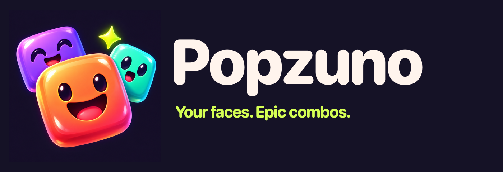

# Popzuno & Familytris

## Popzuno — güncel oyun

Fotoğraflarla kişiselleştirilebilen, beş modlu çevrimdışı eşleştirme oyunu. Güncel sürüm: **0.9.8 (17)**.

- [Oyun kaynakları ve çalıştırma adımları](popzuno/README.md)
- [iPhone projesi](popzuno/ios/README-TR.md) · [Android projesi](popzuno/android/README-TR.md)
- [Logo ve görsel kimlik](popzuno/branding/README-TR.md)
- [Canlı destek ve gizlilik sitesi](https://popzuno.frostytang32768.chatgpt.site/)
- [Destek sitesinin kaynakları](popzuno/publication/site/dist/)

Kod, varsayılan karakterler, sesler, lisans bildirimleri ve mağaza taslakları `popzuno/` klasöründedir. Kişisel fotoğraflar, yerel hesap işlemleri, imzalama anahtarları, geliştirici araçları ve derlenmiş paketler Git'e dahil edilmez. Mağaza yayını henüz yapılmadı.

## Önceki BLOK / Familytris oyunu

Önceki oyunun kaynakları ve Android/Pages geliştirmeleri deponun kökünde korunmuştur. Aşağıdaki açıklama bu eski projeye aittir.

---

# BLOK

Türkçe arayüzlü, tarayıcıda çalışan bir blok yerleştirme oyunu. Cyberpunk teması; neon camgöbeği ve pembe ışıklar, çerçeveli bloklar, tarama çizgileri ve ışık izleri içerir. Kurulum veya derleme gerektirmez.

## Çalıştırma

Mac için sunucu gerektirmeyen sürümü üretmek: `node scripts/package-portable.mjs`.

Çıktı `../releases/BLOK-Cyberpunk-Mac/` klasörüne ve yanındaki ZIP dosyasına yazılır. Klasördeki `OYNA.html` dosyası çift tıklamayla açılır. Tüm oyun kodları, stiller ve kullanılan yerel fontlar tek HTML dosyasına gömülür. Node ve Python yalnızca paketi üretirken kullanılır; oynamak için gerekmez.

Geliştirme sürümünü sunucuyla açmak:

`python3 -m http.server 4173 --directory dist`

Ardından http://localhost:4173 adresini açın.

## Kontroller

iPhone ve App Store kaynak projesi `ios/BLOK.xcodeproj` içindedir. Kurulum, imzalama ve gönderim adımları: [iOS açıklaması](ios/README-TR.md). Xcode kurulu değilken iOS derlemesi veya cihaz testi yapılmış sayılmaz.

| Tuş | İşlev |
| --- | --- |
| ← / → | Hareket |
| ↑ / X | Saat yönünde döndür |
| Z | Saat yönünün tersine döndür |
| ↓ | Hızlı indir |
| Space | Anında bırak |
| C | Parçayı sakla |
| P / Esc | Duraklat / devam |

Tablet ve telefonda ekran kontrolleri görünür. Her 10 temizlenen satırda seviye artar. Rekor ve ses tercihi localStorage'da saklanır. Sekmeden ayrıldığınızda oyun duraklar. Ağ bağlantısı olmadan da oyun çalışır; isteğe bağlı web yazı tipleri için sistem yazı tipi yedeği bulunur.

Cyberpunk ses efektleri Web Audio ile tarayıcıda sentezlenir. Hareket, döndürme, saklama, indirme, yerleşme, satır temizleme, seviye geçişi ve oyun sonu farklı efektler kullanır. Sesler ilk kullanıcı etkileşiminde açılır. Üstteki hoparlör düğmesi sesi kapatır; sayfa altındaki kaydırıcı ses düzeyini ayarlar ve “Sesi dene” düğmesi bir efekt çalar. Tercihler tarayıcıda korunur. Arka plana geçiş, yeni oyun veya sesi kapatma, bekleyen efektleri iptal eder.

## Testler

`node --test tests/*.test.mjs`

`dist/engine.mjs` oyun kurallarını, `dist/app.mjs` çizim ve etkileşimi içerir. `dist/style.css` yerleşimi, `dist/cyberpunk.css` görsel temayı tanımlar.

`dist/audio.mjs` ses sentezini ve efekt dizilerini içerir.

## Familytris iPhone sürümü

Onaylanan detaylı karakter görünümü oyuna bağlandı. Ailem düğmesinden en fazla 7 yüz eklenir; yüzler cihazda yakınlaştırılır, çizgi gövdelere yerleşir ve yalnızca yerel kayda alınır. Karakter görselleri dönen, saklanan ve kilitlenen parçalarda korunur; satır temizlenirken kalan parçalar doğru satırlarla taşınır.

39 oyun/ses/kişiselleştirme/iOS köprü testi geçti. Xcode 27.1 ve iOS 27.1 SDK ile simülatör ve gerçek iPhone işlemcisi derlemeleri başarılı. Personal Team yapılandırıldı; imzalı iPhone derlemesi de başarılı. Geliştirici Modu açıldı ve cihaz hazırlığı tamamlandı; uygulamanın açılması iPhone’daki geliştirici sertifikası için güven onayını bekliyor. Cihazda oyun testi ve App Store gönderimi henüz yapılmadı. Xcode projesi ios/BLOK.xcodeproj; iPhone ekranındaki uygulama adı Familytris. Kurulum ayrıntıları ios/README-TR.md dosyasındadır.

## Familytris Android sürümü

Android Studio projesi `android/` klasöründedir. Oyun, yerel WebView içinde çevrimdışı çalışır; rekor, ses ve aile fotoğrafları yalnızca cihazda saklanır. Oyun kaynakları değiştiğinde `npm run prepare:android` çalıştırın. Android Studio kurulumu, cihaz testi ve Google Play yayın adımları: [Android açıklaması](android/README-TR.md).
